  

# 🚀 Awesome Employee Engagement & Pulse Surveys

  <strong>A curated directory of top-tier SaaS platforms, self-hosted open-source software, and developer tools for continuous employee listening, eNPS tracking, 360 feedback, and workforce sentiment analytics.</strong>

  
  
  
  
  
  
  

  <em>Last updated: March 2026 • Curated with ❤️ for People Leaders, People Ops, HR Tech Practitioners, and Developers</em>

---

## 📖 Overview & SEO Summary

This open-source repository indexes market-leading **SaaS enterprise suites** and **open-source GitHub projects** dedicated to **Employee Engagement, Continuous Pulse Surveys, eNPS (Employee Net Promoter Score), and 360-Degree Feedback**. 

Modern organizations leverage these continuous listening solutions to:
- 📈 Measure workforce sentiment dynamically instead of relying on sluggish annual reviews.
- 🎯 Identify key drivers of employee retention, satisfaction, and burnout early.
- 🔒 Secure psychological safety through strictly anonymized feedback channels.
- 🤖 Automate manager 1-on-1 agendas, peer recognition (kudos), and data-driven action plans.

---

## 📑 Table of Contents

- [📊 Sector Overview & Market Dynamics](#-sector-overview--market-dynamics)
- [🏢 SaaS/Hosted Platforms](#-saashosted-platforms)
- [💻 Open-Source GitHub Projects](#-open-source-github-projects)
- [🤝 How to Contribute](#-how-to-contribute)
- [💖 Support & Sponsorship](#-support--sponsorship)
- [📈 Star History](#-star-history)
- [⚠️ Disclaimer](#-disclaimer)

---

## 📊 Sector Overview & Market Dynamics

The global employee engagement software market is valued at approximately **$1.1B–$1.25B in 2025** and projected to reach **$1.4B in 2026** (with the broader Employee Experience Platform / EXP market estimated at **$3.4B to $4.65B**, expanding at ~14–17% CAGR). 

The sector is **moderately fragmented**:
- **Enterprise Core (~25–30% Share)**: Dominated by enterprise cloud ecosystems and specialized suites like Microsoft (Viva Glint), Qualtrics (EmployeeXM), and Workday (Peakon).
- **Point Solutions & Innovative Challengers**: Dozens of specialized vendors (e.g., Lattice, 15Five, Officevibe) and open-source frameworks compete across micro-pulse polling, Slack/Teams bots, gamified peer recognition, and AI comment analysis.
- **Consolidation Trend**: Organizations increasingly shift away from siloed feedback tools toward unified platforms that integrate listening telemetry directly into performance management, OKRs, and manager workflows.

---

## 🏢 SaaS/Hosted Platforms

*Evaluated across company valuation/revenue, capabilities, transparent starting pricing tiers, and trial parameters. Sorted descending by company scale.*

| 🏷️ Product | 🌐 Scale (Valuation / Revenue) | 📝 Description | 💵 Starting Pricing | ⏱️ Free Tier / Trial Limits |
|---|---|---|---|---|
| **[Glint (Microsoft Viva)](https://www.microsoft.com/en-us/microsoft-viva/glint)** | **~$4.0T Market Cap** / ~$346B ARR (Microsoft parent) | **Enterprise listening within Microsoft 365.** Advanced NLP text analytics, driver modeling, and automated executive dashboards integrated across Teams. | **$2.00/user/month** (annual commitment; requires underlying Microsoft 365 license) | No free tier; 90-day trial capped at 50 licenses via enterprise sales |
| **[Workday Peakon](https://www.workday.com/)** | **~$47B Market Cap** / ~$10.1B ARR (Workday parent) | **Continuous adaptive pulse listening.** Tailors pulse cadence per employee and links sentiment telemetry directly with core HCM employee records. | **~$49/employee/year** (~$4.08/emp/mo; slides to ~£14–£28 for large enterprises; ~$20k/yr min spend) | No free tier; sales-guided live demo environment (no self-serve free trial) |
| **[Qualtrics EmployeeXM](https://www.qualtrics.com/)** | **$12.5B Valuation** (take-private) / ~$1.5B ARR | **Scientific research-grade listening suite.** Deep lifecycle surveying (onboarding, exit), always-on listening, open-text AI clustering, and statistical driver analysis. | **~$25,000/year platform floor** (custom per-employee quote based on total headcount) | No free tier; sales demo sandbox (self-serve trial limited to generic market surveys) |
| **[Lattice](https://lattice.com/)** | **$3.0B Valuation** (peak venture) / ~$130M ARR | **Engagement united with performance.** Engagement pulses and eNPS natively tie into performance reviews, OKRs, and 1:1 manager agenda action items. | **$4/seat/month** for Engagement module (or $13/seat/month Foundations bundle; $4,000/yr annual floor) | No free tier; interactive product tours and demo sandboxes only |
| **[Culture Amp](https://www.cultureamp.com/)** | **$1.5B Valuation** / ~$177M ARR | **The industry standard for engagement benchmarks.** Validated scientific survey templates, global cross-industry benchmarks, and turnover driver analysis. | **~$5.00–$9.00/employee/month** (billed annually; minimum platform spend starts at ~$4,500/year) | No free tier; sales-guided product demo (no self-serve free trial) |
| **[Workleap Officevibe](https://workleap.com/officevibe/)** | **$125M CAD Growth Round** / ~$100M+ CAD ARR (Workleap/GSoft parent) | **Lightweight pulse feedback for SMBs.** Simple weekly pulse check-ins, anonymous messaging channels, and manager engagement heatmaps with zero setup friction. | **$5.00/user/month** billed annually ($6.25/mo billed monthly; 10-user minimum / $50/mo floor) | 14-day free trial (full feature access, no credit card required; perpetual free plan phased out) |
| **[15Five](https://www.15five.com/)** | **~$94M Total Funding** / ~$95M ARR | **Engagement paired with manager habits.** Combines continuous check-ins and blocker tracking with company-wide pulse surveys and manager training playbooks. | **$4.00/user/month** (Engage tier, billed annually; Perform is $11/mo, Total Platform $16/mo) | 14-day free trial available upon sales request (no permanent free tier) |
| **[TINYpulse](https://www.tinypulse.com/)** | **$75M Parent Acquisition** (Limeade by WebMD / $9M TINYpulse buyout) / ~$6.5M ARR | **Focused pulse surveying & peer recognition.** Weekly sentiment trends paired with "Cheers for Peers" social recognition and anonymous suggestions. | **~$5.00/user/month** (entry tier; custom annual contract based on headcount and module selection) | No permanent free tier; sales-assisted demo and trial access upon consultation |

---

## 💻 Open-Source GitHub Projects

*Self-hostable engagement suites, privacy-preserving pulse survey engines, competency management tools, and validated survey taxonomies. Sorted descending by GitHub stargazers count.*

| 📦 Repository | ⭐ Stars_Badge | 🛠️ Tech Stack & Focus | 📝 Description |
|---|---|---|---|
| **[Formbricks](https://github.com/formbricks/formbricks)** |  | TypeScript, Next.js, Tailwind CSS, Prisma | **The most versatile open-source survey platform for employee & user feedback.** Full experience management suite: distribute in-app, link, or email pulse surveys; analyze aggregated sentiment with rich dashboards; and trigger automated webhooks. Self-hostable with APIs and SDKs. |
| **[Meeds](https://github.com/Meeds-io/meeds)** |  | Java, Vue.js, Docker, Web3 | **Open-source decentralized employee engagement & recognition platform.** Fosters employee engagement, peer recognition, and workplace community through gamified recognition hubs, social kudos, and reward structures. |
| **[Teams New Employee Onboarding & Pulse](https://github.com/OfficeDev/microsoft-teams-apps-newemployeeonboarding)** |  | C#, Microsoft Teams SDK, SharePoint | **Microsoft Teams app for onboarding feedback and automated pulse surveys.** Production-ready Teams solution enabling HR and People Ops to schedule recurring pulse checks, manage new hire check-ins, and capture direct sentiment feedback within Teams. |
| **[HRPulsar](https://github.com/HRPulsar/hrpulsar)** |  | Python, FastAPI, Next.js, PostgreSQL | **Open-source talent, 360° feedback & competency management platform.** Enables organizations to conduct 360-degree employee appraisals, map skill matrices, run continuous competency evaluations, and track professional growth pathways. |
| **[Blik](https://github.com/thijsdezoete/blik)** |  | Ruby on Rails, PostgreSQL | **Self-hosted & open-source anonymous 360-degree review tool.** Designed specifically for peer review cycles, anonymous upward evaluations, and frictionless team sentiment gathering without vendor lock-in. |
| **[Employee Survey Questions Genome](https://github.com/joyouslabs/employee-survey-questions)** |  | Curated Science Dataset / Taxonomies | **Scientifically validated question framework for employee listening.** Open repository of proven questions measuring employee sentiment, psychological safety, eNPS, inclusion, manager support, and workplace well-being. |
| **[Check-Ins (Object Computing)](https://github.com/objectcomputing/check-ins)** |  | Java, Micronaut, React, GCP/On-Prem | **Comprehensive open-source team engagement platform.** Features periodic pulse surveys to assess team sentiment, structured feedback management, mentor-mentee tracking, milestone celebrations, and automated Slack kudos. |
| **[employee-pulse-survey-enps-engine](https://github.com/ejajmahmud/employee-pulse-survey-enps-engine-fastapi-cve-patch-bot-v2026-b63)** |  | Python 3.12, FastAPI, LangChain, Docker | **Microservice backend for weekly pulse surveys and eNPS calculation.** Collects continuous feedback, computes real-time Employee Net Promoter Scores, and runs diagnostics algorithms to surface early team burnout risks. |
| **[Sum (ETH Belgrade)](https://github.com/pzprado/eth-belgrade)** |  | Next.js, Tailwind CSS, iExec Confidential Computing | **Decentralized anonymous pulse surveys using confidential computing.** Experimental privacy architecture where employee pulse answers are hardware-encrypted to guarantee mathematical anonymity for sensitive workplace feedback. |

---

## 🤝 How to Contribute

We welcome contributions from the community! To suggest a new open-source project or SaaS platform:

1. 🍴 Fork the repository.
2. 🌿 Create a descriptive branch: `git checkout -b add-tool-name`.
3. 📝 Update `README.md` following the established table schema (ensure all pricing, trial limits, and stargazers badges are included).
4. 🚀 Push your changes and open a Pull Request with a brief summary of the project.

---

## 💖 Support & Sponsorship

If you find this curated collection valuable for your HR tech research, open-source initiatives, or company projects, please consider supporting the project:

- ⭐ **Star this repository** on GitHub to help others discover it.
- 🍴 **Fork and share** with fellow people ops leaders, software architects, and founders.
- ☕ **Support the maintainer**: You can buy me a coffee or sponsor ongoing maintenance directly on the [GitHub Sponsors Dashboard](https://github.com/sponsors/ishandutta2007).

Thank you for helping build a more transparent, data-informed, and human-centric workplace! 🙌

---

## 📈 Star History

---

## ⚠️ Disclaimer

- This is a community-curated list compiled for informational and technical comparison purposes—it does not constitute an explicit commercial endorsement.
- Employee engagement platforms process confidential and sensitive workforce sentiment data. Organizations must verify strict anonymity safeguards, role-based access control, GDPR/CCPA compliance, and SOC 2 certifications before deployment.
- Pricing metrics, trial tiers, and packaging models reflect verified vendor terms as of 2026 and are subject to change by respective platform providers.
